# Ergo-L pour Silakka54

Firmware [QMK](https://qmk.fm) pour le clavier [Silakka54](https://github.com/Squalius-cephalus/silakka54)
qui tape en [Ergo-L](https://ergol.org) sur un ordinateur resté en **AZERTY français**.

C'est le clavier qui fait la traduction : il envoie à l'ordinateur les touches AZERTY qui
produisent les caractères Ergo-L. Rien à installer, aucun droit administrateur, aucun réglage à
faire sur l'ordinateur : on le branche, sous Windows, Linux ou macOS, et il tape en Ergo-L.

## Démarrage rapide

1. Télécharger le firmware : [`silakka54_ergol.uf2`](https://github.com/valcol/QMK-Ergo-L/releases/latest/download/silakka54_ergol.uf2).
2. Le [flasher](#flasher) sur les deux moitiés.
3. Brancher l'USB sur la moitié **gauche**.
4. Sous Linux ou macOS, [indiquer l'OS](#choisir-los) au clavier (il est en mode Windows par défaut).

## Disposition

### Base

<picture>
  <source media="(prefers-color-scheme: dark)" srcset="docs/base-dark.svg">
  
</picture>

Chaque touche porte jusqu'à quatre caractères :

| Coin | Ce qui sort |
|---|---|
| en haut à gauche | avec Maj (pour une lettre, la touche seule donne la minuscule) |
| en bas à gauche | la touche seule |
| en bas à droite, en orange | ★ puis la touche |
| en haut à droite, en orange | ★ puis Maj + la touche (pour une lettre, la majuscule : Â, É, Ç…) |

**★ est une touche morte** : on la tape, on la relâche, puis on tape la touche voulue. ★ puis `s`
donne é, ★ puis Maj+`s` donne É, ★ puis Espace donne l'apostrophe typographique ’. ★ deux fois
donne le tréma mort ¨ (pour ä, ë, ö, ü, ÿ). Maj+★ donne `!`.

Aux pouces, **⌫** efface quand on le tape et active la couche **Nav** quand on le maintient ;
**Sym** active la couche des symboles tant qu'on le maintient.

### Sym (pouce droit maintenu)

<picture>
  <source media="(prefers-color-scheme: dark)" srcset="docs/sym-dark.svg">
  
</picture>

L'équivalent de la couche AltGr d'Ergo-L, sous le pouce.

### Nav (⌫ maintenu au pouce gauche)

<picture>
  <source media="(prefers-color-scheme: dark)" srcset="docs/nav-dark.svg">
  
</picture>

Navigation et édition à gauche, pavé numérique à droite.

### Réglages

Maintenir Nav et Sym (dans n'importe quel ordre), puis taper :

| Touche Ergo-L | Effet |
|---|---|
| `w` | mode Windows |
| `l` | mode Linux |
| `m` | mode macOS |
| Échap | mode flash, pour mettre à jour le firmware |

Le mode choisi reste en mémoire dans le clavier, même débranché.

## Choisir l'OS

Les caractères absents de l'AZERTY (œ, «, É…) ne s'obtiennent pas de la même façon selon l'OS : le
clavier doit donc savoir sur quoi il est branché. Il est en mode **Windows** par défaut ; pour
changer, voir [Réglages](#réglages).

Côté ordinateur, la disposition doit être la suivante :

| OS | Disposition | Caractères hors AZERTY |
|---|---|---|
| Windows | Français (France) | codes Alt `Alt+0nnn` (Verr Num est activé tout seul au besoin) |
| Linux | `fr`, variante par défaut | AltGr (æ ß « » ’ • · ¡ ¿), sinon `Ctrl+Maj+U` (œ ñ – — …) |
| macOS | **Français** (pas « Français – PC »), clavier de type ISO | touches Option |

Sous Linux et macOS, À É È Ç Ù passent par Verr Maj (Verr Maj + é = É).

## Raccourcis

Les raccourcis suivent les lettres Ergo-L, comme avec le vrai pilote : Ctrl+C est sur la touche `c`
d'Ergo-L, pas sur celle de l'AZERTY. Ceux de la couche Nav (Annuler, Copier…) utilisent Cmd sous
macOS.

Avec Ctrl, Alt ou Win, une touche de chiffre ou de symbole envoie la touche AZERTY qui porte ce
caractère, sans Maj ni AltGr. Ctrl+`1` donne donc Ctrl+1, et Ctrl+`/` donne Ctrl+`:` (commenter
une ligne dans VS Code en AZERTY). Revers : sous Windows et Linux, Ctrl+`@` donne Ctrl+0.

## Répétition

Les touches se répètent quand on les maintient. Un caractère qui tient en une touche AZERTY est
répété par l'OS ; une séquence (ê, ou œ sous Windows…) est rejouée par le clavier, après 500 ms
puis toutes les 80 ms.

Exception : ⌫ au pouce gauche active Nav quand on le maintient. Pour effacer en continu, le taper
puis le maintenir aussitôt, ou utiliser le ⌫ de droite.

## Limites

- **Windows** : les codes Alt marchent dans la plupart des applications, mais pas toujours dans
  les terminaux, en bureau à distance (RDP, Citrix) ou dans une machine virtuelle.
- **Linux** : `Ctrl+Maj+U` est compris par GTK et IBus (GNOME, Ubuntu…). Sous KDE sans IBus ni
  Fcitx, œ ñ – — … ne sortent pas.
- **macOS** : si `<` `>` et `@` `#` sont inversés, macOS a pris le clavier pour un modèle ANSI ;
  le corriger dans Réglages › Clavier › Type de clavier → **ISO (Europe)**. La puce • n'a pas
  encore été vérifiée.
- **Verr Maj** (Linux, macOS) : si la touche Verr Maj est réaffectée (options xkb `caps:escape` ou
  `ctrl:nocaps`, touches de modification de macOS, « Verr Maj change de source de saisie »),
  À É È Ç Ù ne sortent pas (on obtient par exemple Échap puis é).
- **★ incomplet** : la rangée des chiffres de ★ („ “ ” ‘ ’ ¢ ‰ § ¶ °), la touche morte grecque
  (★ puis `g`), le trait d'union insécable (★ puis `-` donne un simple -) et les espaces
  insécables (Maj+Espace) d'Ergo-L ne sont pas émulés.
- **Autres dispositions** : « Français – PC » (macOS), `oss` ou `latin9` (Linux) et l'AZERTY NF ne
  sont pas prises en charge ; certains symboles seraient faux.

## Flasher

Aucun logiciel n'est nécessaire : en mode flash, chaque moitié du Silakka54 apparaît comme une clé
USB sur laquelle on copie le firmware. N'importe quel ordinateur convient, sauf ceux qui bloquent
les clés USB (c'est fréquent sur les PC d'entreprise).

La première fois, sur **chaque moitié**, avec le même fichier :

1. Débrancher le clavier et le câble qui relie les deux moitiés.
2. Maintenir le bouton **BOOT** du RP2040 et brancher la moitié en USB : un lecteur `RPI-RP2` apparaît.
3. Copier `silakka54_ergol.uf2` dessus. Le lecteur disparaît et la moitié redémarre.
4. Recommencer avec l'autre moitié, puis tout rebrancher, USB sur la moitié **gauche**.

Pour les mises à jour, Nav + Sym + Échap met la moitié gauche en mode flash sans toucher au bouton
BOOT ; la moitié droite, elle, demande toujours le bouton. Comme c'est la moitié gauche qui traite
tout le keymap, la reflasher seule suffit en général ; si le clavier se comporte bizarrement,
reflasher les deux.

## Modifier et compiler

Tout est dans [`keyboards/silakka54/keymaps/ergol/keymap.c`](keyboards/silakka54/keymaps/ergol/keymap.c).
Il n'y a pas de Vial : chaque modification passe par ce fichier et un nouveau flash.

**Avec GitHub** : chaque push compile le firmware (GitHub Actions) et le publie dans la
[dernière release](https://github.com/valcol/QMK-Ergo-L/releases/latest).

**En local, avec Docker** (sans installer QMK) :

```sh
docker run --rm -v "$PWD:/userspace" ghcr.io/qmk/qmk_cli bash -c '
  git clone -q --depth 1 --recurse-submodules --shallow-submodules https://github.com/qmk/qmk_firmware /qmk_firmware &&
  qmk config user.qmk_home=/qmk_firmware user.overlay_dir=/userspace &&
  cd /qmk_firmware && qmk compile -kb silakka54 -km ergol'
```

Sous Windows avec Git Bash, remplacer la première ligne par
`MSYS_NO_PATHCONV=1 docker run --rm -v "$(pwd -W):/userspace" ghcr.io/qmk/qmk_cli bash -c '`.
Le firmware `silakka54_ergol.uf2` arrive à la racine du dépôt.

Les schémas de la disposition sont générés par `python docs/layout.py`. Le script ne lit pas le
keymap : après une modification de la disposition, reporter le changement dans ses tableaux, puis
le relancer.

## Licence

GPL-2.0 ou ultérieure, comme QMK : voir [LICENSE](LICENSE).
